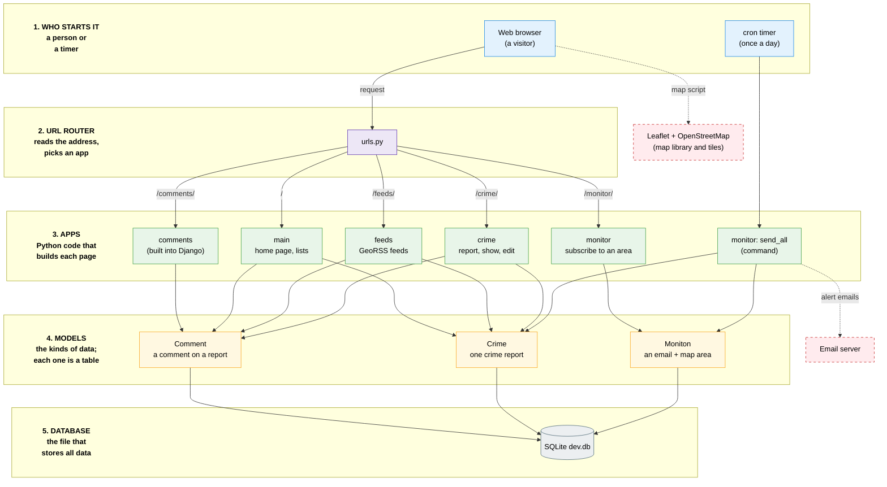

# Architecture overview

MalaysiaCrime is a Django 1.3.1 website running on Python 2.7. People mark a crime on a map, and other people can comment on it (posting comments is turned off now). Anyone can also subscribe to an area of the map and get email alerts about new reports there.

The code has four Django apps: `crime`, `main`, `feeds` and `monitor`. All four depend on one shared model, `Crime`, in [`crime/models.py`](../crime/models.py).

## Diagram

The diagram has five layers, and you read it from the top. A visitor's browser starts most actions, and a cron timer on the server starts the daily email job. Next is `urls.py`, which looks at the start of the address (like `/crime/`) and picks an app. An app is a folder of Python code for one part of the site, and its views (Python functions) build the pages. `send_all` is in the `monitor` app too, but you run it from the command line instead of a web page.

Under the apps are the models. Each model is one kind of data, and Django saves it as a table: `Crime` is a crime report, `Comment` is a comment on one, and `Moniton` is an email address with a map area. Most of the arrows end at `Crime`, since almost every app reads crime reports. At the bottom, all the tables live in one SQLite file, `dev.db`.

The red dashed boxes are services outside our project. The browser downloads the Leaflet map library from unpkg.com and the map pictures (tiles) from OpenStreetMap, so the map only works when you're online. `send_all` sends its alerts through an email server, and our Docker setup doesn't have one.

The diagram is also saved as [`images/architecture.png`](images/architecture.png) and [`images/architecture.svg`](images/architecture.svg). To change it, edit [`images/architecture.mmd`](images/architecture.mmd) and render it again. If you'd rather move the boxes by hand, open [`images/architecture.excalidraw`](images/architecture.excalidraw) on [excalidraw.com](https://excalidraw.com) (File, then Open). That file has the same boxes, arrows and layer names, just without the grey background behind each layer.

## How a request moves through the code

1. The browser asks for a URL, for example `/crime/create/`.
2. [`urls.py`](../urls.py) in the project root looks at the first part of the path and sends the request to one app:

   | Path starts with | Goes to | URL file |
   | --- | --- | --- |
   | `/` | `main` | [`main/urls.py`](../main/urls.py) |
   | `/crime/` | `crime` | [`crime/urls.py`](../crime/urls.py) |
   | `/monitor/` | `monitor` | [`monitor/urls.py`](../monitor/urls.py) |
   | `/feeds/` | `feeds` | [`feeds/urls.py`](../feeds/urls.py) |
   | `/comments/` | Django's built-in comments app | (inside Django) |
   | `/admin/` | Django's built-in admin site | (inside Django) |
   | `/static/` | CSS and images in [`static/`](../static) | only when `DEBUG = True` |

3. The view function in that app reads or writes the database through a model, then fills in an HTML template from [`templates/`](../templates).
4. Every page loads Leaflet 1.9.4 in [`templates/base.html`](../templates/base.html) (lines 11-12), and each page's own template uses it to draw its map. WP3 and WP4 replaced Google Maps API v2 with Leaflet. Two templates, `main/recent_commented.html` and `main/recent_updated.html`, still call Google Maps, so their map stays empty (see [Things to know](#things-to-know-before-you-change-code)).

## The four apps

### `crime`: crime reports

This is the main app. All four apps use its `Crime` model, and it has the pages to create, show and edit a report.

- [`models.py`](../crime/models.py) has the `Crime` model. Each report has a headline, date, location text, map position (`lat`, `lng`, `zoom`), an icon type, details, the author's name, the IP address of whoever posted it, an edit password and an `is_removed` flag. `save()` makes the URL slug from the headline. The same file has `recently_commented()`, which finds the reports with the newest comments. Both `main` and `feeds` use it. WP7 moved it here so the query is only written once.
- [`passwords.py`](../crime/passwords.py) turns the edit password into a hash (PBKDF2 with SHA-256, 600,000 rounds) before it's saved, and checks the password when someone edits a report. WP5 added it, so passwords aren't saved as plain text anymore.
- [`views.py`](../crime/views.py) has `create`, `update`, `show` (redirects from an id to the slug URL) and `title` (shows a report by its slug).
- The report page, [`templates/crime/show.html`](../templates/crime/show.html), also lists the comments on that report using Django's comments app. The form for posting a new comment is inside a `` block (lines 63-110), so it doesn't show. The original author turned it off in October 2011 (commit `375ff40`).
- [`forms.py`](../crime/forms.py) has `CrimeCreateForm` and `CrimeUpdateForm`. To edit a report, all you need is the password that was set when the report was made.
- [`migrations/`](../crime/migrations) has five South migrations. WP5 added `0004`, which makes the password field longer (128 characters) so a hash fits, and `0005`, which turns the passwords already in the database into hashes. You can't undo `0005`. `crime` is the only app that uses South, so its tables are made by `manage.py migrate`, not by `syncdb`.
- [`admin.py`](../crime/admin.py) shows the reports in the Django admin site.

URLs: `/crime/create/`, `/crime/update/<id>/`, `/crime/show/<id>/`, `/crime/title/<slug>/`.

### `main`: home page and lists

`main` has no model of its own. It reads `Crime` and Django's `Comment` model.

- [`views.py`](../main/views.py) has three views:
  - `index` is the home page. It shows the newest reports, 20 per page, in a list and on the map. `/?page=2` shows the next 20, and a page number that doesn't exist gives a 404 error. WP7 added the pages. Before that, the home page loaded up to 500 reports at once.
  - `recent_updated` shows the 200 reports that were changed most recently.
  - `recent_commented` shows the reports with the newest comments, using `recently_commented()` from `crime/models.py`.
- [`urls.py`](../main/urls.py) also serves a few simple template pages (`/about/`, `/search/`), plus `icons.js`, `robots.txt` and `sitemap.xml`.

URLs: `/`, `/recent/updated/`, `/recent/commented/`, `/about/`, `/search/`, `/sitemap.xml`.

### `feeds`: RSS feeds with map positions

`feeds` makes GeoRSS feeds, which are RSS feeds where each item also has a point on the map.

- [`feeders.py`](../feeds/feeders.py) has three feed classes:
  - `LatestEntries`: the 50 newest reports.
  - `UpdatedEntries`: the 10 reports that were changed most recently.
  - `CommentedEntries`: the reports from the 10 newest comments, using the same `recently_commented()` function as `main`.

URLs: `/feeds/latest.xml`, `/feeds/updated.xml`, `/feeds/commented.xml`.

`feeds` isn't in `INSTALLED_APPS` in [`settings_default.py`](../settings_default.py). The feed URLs still work because `urls.py` includes them, but `manage.py test feeds` fails with "App with label feeds could not be found".

### `monitor`: email alerts for an area

A visitor draws a box on the map and types an email address. Once a day, a script emails them the new reports inside that box.

- [`models.py`](../monitor/models.py) has the `Moniton` model (short for "monitoring unit"). It stores the email, the edges of the box (`top`, `right`, `bottom`, `left`), the map centre and zoom, and a unique `uuid` that goes into the unsubscribe and information links.
- [`views.py`](../monitor/views.py) has `subscribe`, `unsubscribe` and `information` (shows the area someone subscribed to).
- [`management/commands/send_all.py`](../monitor/management/commands/send_all.py) runs as `python manage.py send_all`. It finds the reports from the last 24 hours and emails each subscriber the ones inside their box. The original site ran it from a cron job (a timer on the server). Nothing in this repository or in our Docker setup runs it automatically.
- [`admin.py`](../monitor/admin.py) shows the subscriptions in the Django admin site.

URLs: `/monitor/subscribe/`, `/monitor/unsubscribe/<uuid>/`, `/monitor/info/<uuid>/`.

## Project-level files

| File or folder | What it does |
| --- | --- |
| [`settings_default.py`](../settings_default.py) | Template for `settings.py`. When the container starts, Docker copies it to `settings.py` if there isn't one yet. It uses SQLite (`dev.db`), turns CSRF protection on, and reads `SECRET_KEY` from an environment variable. If `SECRET_KEY` isn't set, it stops with an error. |
| [`__init__.py`](../__init__.py) | Makes the project folder a Python package called `malaysiacrime`. It also has `SetRemoteAddrFromForwardedFor`, a middleware that copies the `X-Forwarded-For` header into `REMOTE_ADDR`. Since WP5 it only does this when the header is a valid IPv4 address. It still can't tell who sent the header, so on a real server only a trusted proxy should set it. |
| [`urls.py`](../urls.py) | The root URL router (see the table above). |
| [`manage.py`](../manage.py) | Django's command-line tool (`runserver`, `syncdb`, `migrate`, `test`, `send_all`). |
| [`templates/`](../templates) | The HTML templates used when the site runs. `base.html` is the layout every page shares. |
| [`static/`](../static) | CSS in `stylesheets/` (based on Blueprint), images and map icons. |
| `crime/templates/`, `main/templates/`, `monitor/templates/` | A second, older copy of most templates. The tests use these (see below). |
| [`MAINTENANCE_CSRF_SECURITY.md`](../MAINTENANCE_CSRF_SECURITY.md), [`WP7_REPORT.md`](../WP7_REPORT.md) | Reports from WP5 and WP7 about what they changed and how they tested it. |

## How the apps connect

| App | Uses `Crime` | Uses `Comment` | Own model |
| --- | --- | --- | --- |
| `crime` | yes (owns it) | yes (the report page lists comments) | `Crime` |
| `main` | yes | yes | none |
| `feeds` | yes | yes | none |
| `monitor` | yes (`send_all.py`) | no | `Moniton` |

Every app reads `Crime`, so changing a field in [`crime/models.py`](../crime/models.py) can break all four apps. Before you change that model, go through every row in this table, and don't forget to add a South migration.

## Things to know before you change code

These are the problems we know about so far. The "WP" column says which work package is handling each one. WP3, WP4, WP5, WP6 and WP7 already fixed the map on most pages, the security problems and the "recently commented" crash, so we took those out of the list.

| Problem | Where | WP |
| --- | --- | --- |
| The Commented and Recently updated pages still call Google Maps API v2 (`GMap2`), which is shut down, so their map is empty. Their lists still work. | `templates/main/recent_commented.html`, `templates/main/recent_updated.html` | not assigned |
| The admin template problem reported during WP2 needs a fresh browser check. WP6 supplied the sitemap template and its passing endpoint test. | Admin template lookup; `templates/sitemap.xml`; `main/tests.py` | admin follow-up not assigned |
| Subscribing gives error 500 (`NameError`) when the email can't be sent, which always happens in Docker. The subscription is saved before that. `smtplib` and `HttpResponseRedirect` are used but never imported. | `monitor/views.py` line 33 (`smtplib`), lines 40, 59, 73 (`HttpResponseRedirect`) | not assigned |
| You can't post comments, because the comment form is inside a `` block | `templates/crime/show.html` lines 63-110 | not assigned |
| The sample comments use `content_type` 11, which isn't the `Crime` type in a new database. They show up in the Commented list (which only reads `object_pk`) but not on the report pages. | `main/fixtures/comments.json` | not assigned |

### Two copies of the templates

Most templates exist twice: once in the root [`templates/`](../templates) folder and once inside each app (for example `main/templates/main/index.html`). The two copies are different.

- When the site runs, Django looks in the root `templates/` folder first, so it uses the root copy.
- Crime and monitor view tests temporarily select the app copies and register cleanup to restore `TEMPLATE_DIRS`, including after failures. WP6 removed the earlier import-time global mutation; see [WP6 testing notes](wp6-testing.md).

So if you change a page, change the root copy, and if a test checks that page, see whether the app copy needs the same change.

WP6 also replaced the dummy feed tests and corrected the notification rectangle check. These are completed maintenance changes, rather than outstanding defects. The [WP8 register](WP8_CONTRIBUTIONS.md) links their merged PR and verification evidence.
