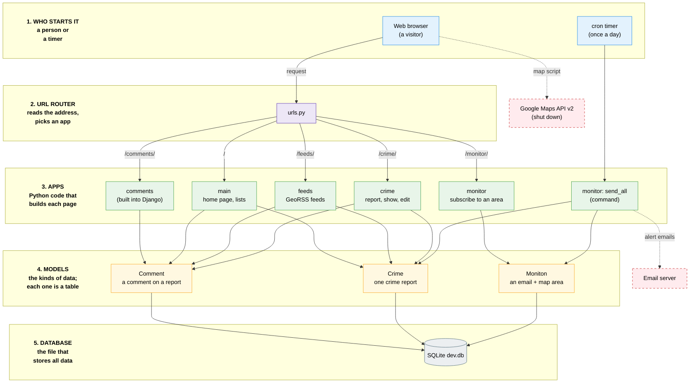

# Architecture overview

MalaysiaCrime is a Django 1.3.1 website that runs on Python 2.7. People mark a crime on a map and other people comment on it (posting comments is turned off now). Anyone can also subscribe to an area of the map to get email alerts about new reports there.

The code is split into four Django apps: `crime`, `main`, `feeds` and `monitor`. All four apps depend on one shared model, `Crime`, in [`crime/models.py`](../crime/models.py).

## Diagram

Read the diagram from top to bottom. Each grey band is one layer, and the layer name is written on the left.

1. Who starts it: most actions start from a visitor's web browser. The daily email job is started by a cron timer on the server.
2. URL router: `urls.py` reads the start of the address (for example `/crime/`) and chooses the app that handles it.
3. Apps: a Django app is a folder of Python code for one part of the site. The views (Python functions) in the app build the pages. `send_all` is part of the `monitor` app, but it runs from the command line instead of from a web page.
4. Models: a model describes one kind of data, and Django saves each model as one table in the database. `Crime` is one crime report, `Comment` is a comment on a report, and `Moniton` is an email address with a map area. Most arrows go to `Crime`, because almost every app reads crime reports.
5. Database: all the tables are saved in one SQLite file, `dev.db`.

The red dashed boxes are services outside the project. The browser loads the map from Google Maps API v2, which is shut down, so the map does not show. `send_all` sends its alerts through an email server, and our Docker setup does not include one.

The diagram is also saved as [`images/architecture.png`](images/architecture.png) and [`images/architecture.svg`](images/architecture.svg). To change it, edit [`images/architecture.mmd`](images/architecture.mmd) and render it again. You can also open [`images/architecture.excalidraw`](images/architecture.excalidraw) on [excalidraw.com](https://excalidraw.com) (File, then Open) if you want to move the boxes by hand. That file has the same boxes, arrows and layer names, but the grey bands are missing because the converter cannot make them.

## How a request moves through the code

1. The browser asks for a URL, for example `/crime/create/`.
2. [`urls.py`](../urls.py) in the project root looks at the first part of the path and sends the request to one app:

   | Path starts with | Goes to | URL file |
   | --- | --- | --- |
   | `/` | `main` | [`main/urls.py`](../main/urls.py) |
   | `/crime/` | `crime` | [`crime/urls.py`](../crime/urls.py) |
   | `/monitor/` | `monitor` | [`monitor/urls.py`](../monitor/urls.py) |
   | `/feeds/` | `feeds` | [`feeds/urls.py`](../feeds/urls.py) |
   | `/comments/` | Django's built-in comments app | (inside Django) |
   | `/admin/` | Django's built-in admin site | (inside Django) |
   | `/static/` | CSS and images in [`static/`](../static) | only when `DEBUG = True` |

3. The view function in that app reads or writes the database through a model. Then it fills in an HTML template from [`templates/`](../templates).
4. The page loads Google Maps API v2 in [`templates/base.html`](../templates/base.html) (line 11) to draw the map. Google has shut this API down, so the map area stays empty. WP3 and WP4 will replace it with Leaflet and OpenStreetMap.

## The four apps

### `crime`: crime reports

Most of the site is built around this app. It has the `Crime` model and the pages to create, show and edit a report.

- [`models.py`](../crime/models.py) has the `Crime` model. Each report has a headline, date, location text, map position (`lat`, `lng`, `zoom`), an icon type, details, the author's name, the IP address of the person who posted it, an edit password and an `is_removed` flag. `save()` makes the URL slug from the headline.
- [`views.py`](../crime/views.py) has `create`, `update`, `show` (redirects from an id to the slug URL) and `title` (shows a report by its slug).
- The report page, [`templates/crime/show.html`](../templates/crime/show.html), also lists the comments on that report using Django's comments app. The form for posting a new comment is inside a `` block (lines 57-104), so it is not shown. The original author turned it off in October 2011 (commit `375ff40`).
- [`forms.py`](../crime/forms.py) has `CrimeCreateForm` and `CrimeUpdateForm`. To edit a report you only need the password that was set when the report was made.
- [`migrations/`](../crime/migrations) has three South migrations. `crime` is the only app that uses South, so its tables are created by `manage.py migrate` and not by `syncdb`.
- [`admin.py`](../crime/admin.py) shows the reports in the Django admin site.

URLs: `/crime/create/`, `/crime/update/<id>/`, `/crime/show/<id>/`, `/crime/title/<slug>/`.

### `main`: home page and lists

`main` does not have its own model. It reads `Crime` and Django's `Comment` model.

- [`views.py`](../main/views.py) has three views:
  - `index` is the home page. It shows the newest 500 reports on the map.
  - `recent_updated` shows the 200 reports that were changed most recently.
  - `recent_commented` shows the reports with the newest comments.
- [`urls.py`](../main/urls.py) also serves some simple template pages (`/about/`, `/search/`), plus `icons.js`, `robots.txt` and `sitemap.xml`.

URLs: `/`, `/recent/updated/`, `/recent/commented/`, `/about/`, `/search/`, `/sitemap.xml`.

### `feeds`: RSS feeds with map positions

`feeds` makes GeoRSS feeds. A GeoRSS feed is an RSS feed where each item also has a map point.

- [`feeders.py`](../feeds/feeders.py) has three feed classes:
  - `LatestEntries`: the 50 newest reports.
  - `UpdatedEntries`: the 10 reports that were changed most recently.
  - `CommentedEntries`: the reports with the newest comments.

URLs: `/feeds/latest.xml`, `/feeds/updated.xml`, `/feeds/commented.xml`.

`feeds` is not in `INSTALLED_APPS` in [`settings_default.py`](../settings_default.py). The feed URLs still work because `urls.py` includes them, but `manage.py test feeds` fails with "App with label feeds could not be found".

### `monitor`: email alerts for an area

A visitor draws a box on the map and types an email address. Once a day, a script emails them the new reports that are inside that box.

- [`models.py`](../monitor/models.py) has the `Moniton` model (short for "monitoring unit"). It stores the email, the edges of the box (`top`, `right`, `bottom`, `left`), the map centre and zoom, and a unique `uuid` that is used in the unsubscribe and information links.
- [`views.py`](../monitor/views.py) has `subscribe`, `unsubscribe` and `information` (shows the area someone subscribed to).
- [`management/commands/send_all.py`](../monitor/management/commands/send_all.py) runs as `python manage.py send_all`. It finds the reports from the last 24 hours and emails each subscriber the ones inside their box. The original site ran it from a cron job (a timer on the server). Nothing in this repository or in our Docker setup runs it automatically.
- [`admin.py`](../monitor/admin.py) shows the subscriptions in the Django admin site.

URLs: `/monitor/subscribe/`, `/monitor/unsubscribe/<uuid>/`, `/monitor/info/<uuid>/`.

## Project-level files

| File or folder | What it does |
| --- | --- |
| [`settings_default.py`](../settings_default.py) | Template for `settings.py`. When the container starts, Docker copies it to `settings.py` if `settings.py` does not exist yet. It uses SQLite (`dev.db`). |
| [`__init__.py`](../__init__.py) | Makes the project folder a Python package called `malaysiacrime`. It also has `SetRemoteAddrFromForwardedFor`, a middleware that copies the `X-Forwarded-For` header into `REMOTE_ADDR` without checking it. |
| [`urls.py`](../urls.py) | The root URL router (see the table above). |
| [`manage.py`](../manage.py) | Django's command-line tool (`runserver`, `syncdb`, `migrate`, `test`, `send_all`). |
| [`templates/`](../templates) | The HTML templates used when the site runs. `base.html` is the layout that every page shares. |
| [`static/`](../static) | CSS in `stylesheets/` (based on Blueprint), images and map icons. |
| `crime/templates/`, `main/templates/`, `monitor/templates/` | A second, older copy of most templates. The tests use these copies (see below). |

## How the apps connect

| App | Uses `Crime` | Uses `Comment` | Own model |
| --- | --- | --- | --- |
| `crime` | yes (owns it) | yes (the report page lists comments) | `Crime` |
| `main` | yes | yes | none |
| `feeds` | yes | yes | none |
| `monitor` | yes (`send_all.py`) | no | `Moniton` |

Every app reads `Crime`, so changing a field in [`crime/models.py`](../crime/models.py) can break all four apps. Before you change that model, check every row in this table, and remember to add a South migration.

## Things to know before you change code

These are the problems we know about. The "WP" column shows which work package is handling each one.

| Problem | Where | WP |
| --- | --- | --- |
| Map does not load (Google Maps API v2 is shut down; 8 templates call `GMap2`). The map fills in the hidden position fields, so the report, edit and subscribe forms cannot be sent. | `templates/base.html` line 11, `templates/crime/`, `templates/main/`, `templates/monitor/` | WP3, WP4 |
| CSRF protection is turned off | `settings_default.py` line 64 | WP5 |
| `SECRET_KEY` is a placeholder written in the code | `settings_default.py` line 53 | WP5 |
| The `X-Forwarded-For` header is trusted without any check | `__init__.py` | WP5 |
| Report edit passwords are saved as plain text | `crime/models.py` line 20, `crime/forms.py` | WP5 |
| `feeds/tests.py` only checks that 1 + 1 = 2 | `feeds/tests.py` | WP6 |
| The area check compares `m.bottom <= m.right` instead of `m.bottom <= x.lat` | `monitor/management/commands/send_all.py` line 27 | WP6 |
| The tests set `TEMPLATE_DIRS` to empty for the whole test run | `crime/tests/__init__.py` lines 5-7, `monitor/tests.py` lines 134-136 | WP6 |
| `recent_commented` can crash. It takes the report ids from the newest 500 comments but only loads the first 200 reports, then loops over all the ids. | `main/views.py` lines 54-57 | WP7 |
| The "recently commented" query is written twice | `main/views.py` lines 54-57, `feeds/feeders.py` lines 33-36 | WP7 |
| The home page loads up to 500 reports at once | `main/views.py` line 17 | WP7 |
| `/admin/` and `/sitemap.xml` give error 500 in Docker (`TemplateDoesNotExist`) | Docker image: Django's own templates are installed in `/usr/local/django/` instead of `site-packages/django/` | not assigned |
| Subscribing gives error 500 (`NameError`) when the email cannot be sent. `smtplib` and `HttpResponseRedirect` are used but never imported. | `monitor/views.py` line 33 (`smtplib`), lines 40, 59, 73 (`HttpResponseRedirect`) | not assigned |
| Visitors cannot post comments, because the comment form is inside a `` block | `templates/crime/show.html` lines 57-104 | not assigned |
| The sample comments use `content_type` 11, which is not the `Crime` type in a new database. They appear in the "Commented" list (which only reads `object_pk`) but not on the report pages. | `main/fixtures/comments.json` | not assigned |

### Two copies of the templates

Most templates exist twice: once in the root [`templates/`](../templates) folder and once inside each app (for example `main/templates/main/index.html`). The two copies are not the same.

- When the site runs, Django looks in the root `templates/` folder first, so it uses the root copy.
- When the tests run, [`crime/tests/__init__.py`](../crime/tests/__init__.py) and [`monitor/tests.py`](../monitor/tests.py) set `TEMPLATE_DIRS` to empty, so Django uses the app copy.

So if you change a page, change the root copy. If a test checks that page, check whether the app copy needs the same change.
